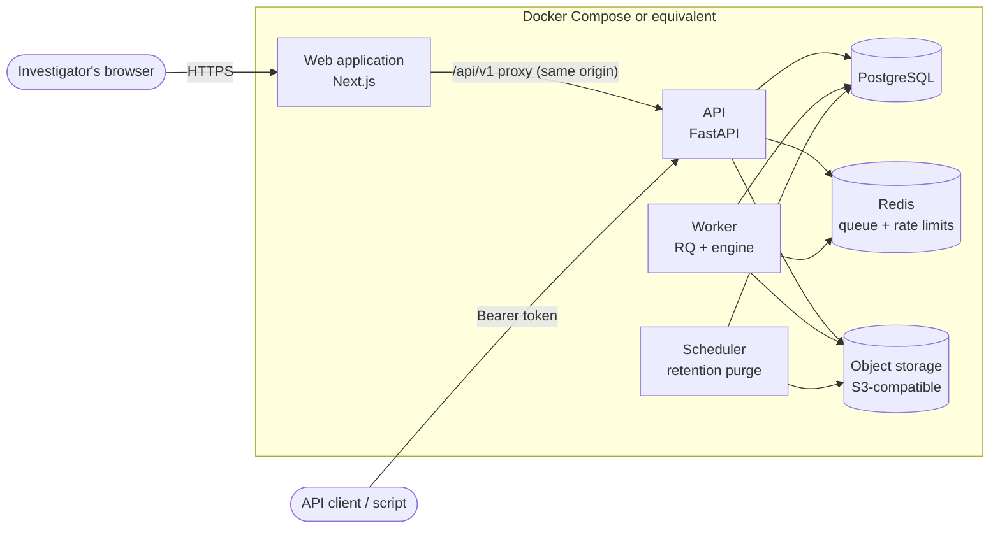
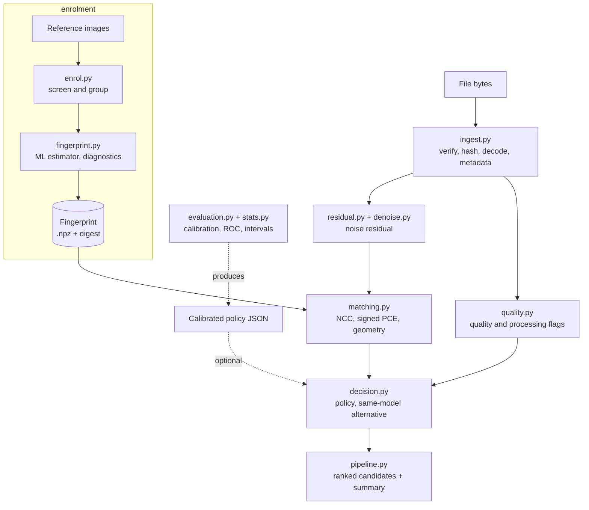
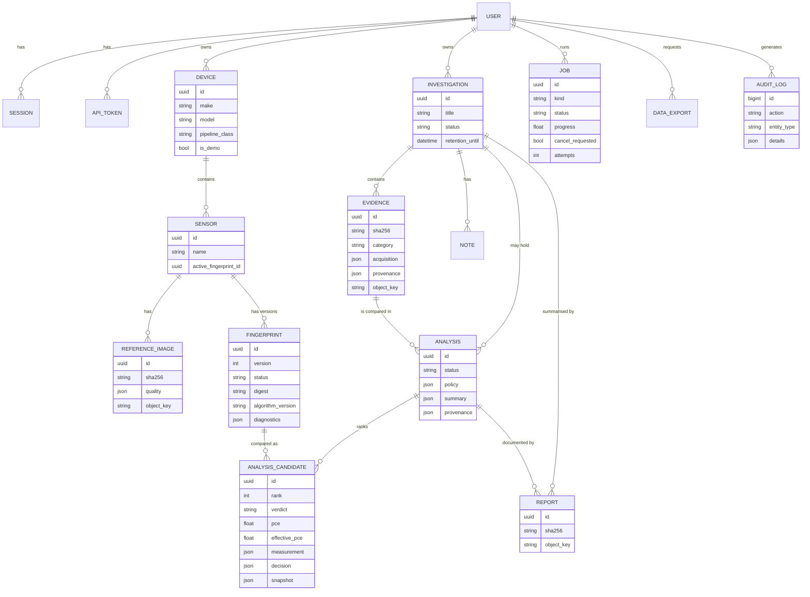
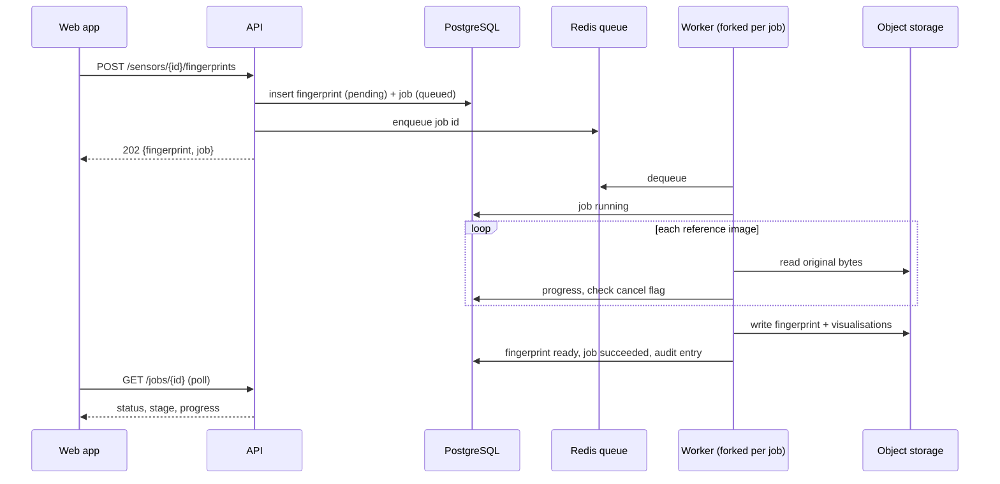

# Architecture

SensorTrace is a modular monolith: a standalone scientific engine, an API with background workers, and a
web application. Decisions and their reasons are recorded in `docs/decisions/`.

## System overview

Only the web application (and optionally the API) is reachable from outside. The worker has no listening
port. The object store is reachable only from the API, the worker and the scheduler.

## Repository layout

| Path | Contents |
|---|---|
| `engine/` | `sensortrace_engine` Python package: algorithms, decision policy, evaluation, CLI, tests |
| `engine/evaluation/` | Evaluation manifests (which devices, which split) |
| `backend/app/` | API: `routers/`, `models.py`, `schemas.py`, `jobs.py`, `storage.py`, `reports.py`, `security.py`, `deps.py` |
| `backend/alembic/` | Database migrations |
| `backend/policies/` | Optional calibrated decision policies (JSON) loaded at start |
| `backend/tests/` | Integration tests against real PostgreSQL, Redis and object storage |
| `frontend/` | Next.js web application and Playwright end-to-end tests |
| `docs/` | ADRs, research notes, OpenAPI document |
| `scripts/` | Dataset and reference-implementation fetch scripts |
| `data/`, `storage/` | Local datasets, evaluation output and development storage. Never committed |

## Engine

The engine has no knowledge of users, databases or HTTP. Everything is plain functions and data classes.

Stable entry points: `ingest_image`, `enrol`, `analyse_questioned`, `Fingerprint.to_bytes/from_bytes`,
`DecisionPolicy`, and the `sensortrace` CLI (`enrol`, `compare`, `evaluate`). Every artefact records
`ALGORITHM_VERSION`; the version must change when numerical output changes.

## Data model

Notes:

- Every user-owned table carries `user_id`. Every read and write goes through `deps.owned()`, which
  returns the same 404 for a missing row and for another user's row.
- `ANALYSIS_CANDIDATE.snapshot` copies the sensor, device and fingerprint details at the time of the
  comparison, so a result stays interpretable if the sensor is later renamed or deleted.
- A fingerprint is immutable once ready. Rebuilding creates a new version; one version is active.
- Evidence may exist without an investigation (uploaded in the comparison laboratory) and be saved into
  one later.
- `AUDIT_LOG` is append-only and is not a foreign key to users, so the fact of an account deletion can
  be recorded after the account is gone. Personal audit entries are removed with the account.

## Storage

| Bucket | Contents | Written | Key pattern |
|---|---|---|---|
| `evidence` | Original uploaded bytes (evidence and reference images) | Once, never modified | `<user>/<kind>/<uuid>.<ext>` |
| `derived` | Previews, fingerprints (`.npz`), visualisations | By the API and the worker | `<user>/<kind>/<uuid>` |
| `results` | PDF reports, data exports | By the API and the worker | `<user>/<kind>/<uuid>` |

Keys are generated by the server. User-supplied filenames are stored only as sanitised display text.
Nothing is publicly readable. Files are served by `GET /api/v1/files/{token}`: the token is an
HMAC-signed, five-minute grant bound to one object and one user, and the request must also be
authenticated as that user. Uploaded originals are always sent as attachments with a generic content
type; only server-generated previews and visualisations render inline.

## Background jobs

- Job kinds: `fingerprint`, `analysis`, `export`.
- The `jobs` table is the source of truth; Redis only carries the queue.
- Cancellation sets a flag that the engine checks between images. A queued job is cancelled immediately.
- Engine errors (bad input) fail at once with a readable message. Unexpected errors are retried twice
  with back-off, then fail with a generic message; details go to the worker log only.
- Each job runs in a freshly forked process with a time limit; the worker container has memory, CPU and
  process limits, a read-only filesystem and no capabilities.

## Request path and authentication

- Browser: the web application proxies `/api/v1/*` to the API, so the browser sees one origin. The
  session is an HttpOnly, SameSite=Lax cookie holding an opaque token (stored hashed). State-changing
  requests must carry the session's CSRF token in `X-CSRF-Token`.
- Programmatic: `Authorization: Bearer st_…` API tokens (stored hashed, revocable, optional expiry). No
  CSRF header is needed; session-only actions (creating tokens, changing the password, deleting the
  account) are refused.
- Rate limits (Redis counters) apply per IP and per account to authentication, and per account to the
  API and to uploads.

## End-to-end workflows

**Enrol a sensor.** Create a device (declaring its processing pipeline) → add a sensor → upload reference
images (each validated, hashed, quality-assessed, previewed) → start a fingerprint job → review accepted
and rejected references, diagnostics and visualisations → the new version becomes active.

**Investigate an image.** Create an investigation → upload evidence with acquisition details → choose
sensors to compare against (include same-model control devices where they exist) → start the comparison
→ review ranked candidates, measurements, reasons, caveats and quality flags → generate the PDF report →
add notes → export or delete.

**Evaluate and calibrate.** Download an evaluation dataset → run `sensortrace evaluate` → review
`report.md` → optionally install the generated `policy.json` in `backend/policies/` to make the
calibrated policy selectable, within its stated scope.

## Extending

- **New algorithm or parameter:** change the engine, bump `ALGORITHM_VERSION`, add regression tests,
  re-run the evaluation. Old results keep their recorded version.
- **New image format:** add a decoder path in `ingest.py` with tests and a licence review.
- **New client (CLI, desktop):** use the engine directly or the REST API (`docs/api/openapi.json`).
- **Future modules** (video, manipulation localisation, scale search) belong in the engine as separate
  modules with their own validation; none exists yet.
