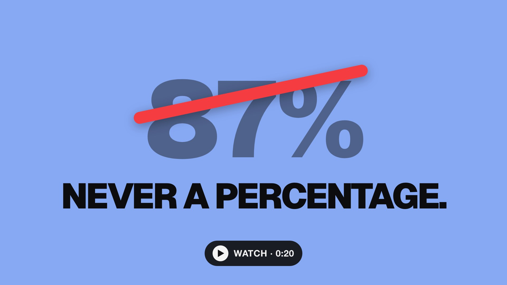

# SensorTrace

[](https://github.com/OmarMohammedSiddique/sensortrace/actions/workflows/ci.yml)
[](LICENSE)
[](https://github.com/OmarMohammedSiddique/sensortrace/releases)
[](https://www.python.org/)
[](https://nextjs.org/)

Camera sensor fingerprinting and image source comparison.

**Live demo: [sensortrace.vercel.app](https://sensortrace.vercel.app)**

## Preview

[](docs/media/sensortrace-launch.mp4)

A 20-second launch video with sound. Select the image to play it. It is rendered from the application's
own components; the questioned photo, its file name and the statistic in the comparison scene are
illustrative, and the struck-out percentage is the kind of figure SensorTrace never reports. See
[docs/media](docs/media/README.md).

## About

SensorTrace tests whether a photograph is consistent with the noise fingerprint of a specific physical
camera sensor. It uses photo-response non-uniformity (PRNU): tiny, fixed pixel-to-pixel differences in
sensitivity that every sensor imprints on its images.

You enrol a sensor from reference photographs, then compare questioned images against it. For each
comparison SensorTrace reports the measurements, a conservative outcome (match supported, non-match
supported, inconclusive, or insufficient quality), the reasons, and the limitations that apply.

**What it is not.** It does not identify an unknown camera from a single image. It does not output a
probability of origin. It is not certified forensic software and makes no claim of courtroom
admissibility. Read [SCIENTIFIC_METHODOLOGY.md](SCIENTIFIC_METHODOLOGY.md) and
[VALIDATION.md](VALIDATION.md) before relying on a result.

Purpose, users, tone and brand rules are in [PRODUCT.md](PRODUCT.md).

## Features

- **Camera laboratory.** Register cameras and their sensors (one per lens and capture mode), declare
  conventional or computational processing, and upload reference images with guidance.
- **Fingerprints.** Screen references, estimate a PRNU fingerprint with diagnostics and visualisations,
  and keep versions. Rejected references come with the reason.
- **Private investigations.** Questioned images (JPEG and PNG) with hashing, metadata, duplicate
  detection, acquisition details, notes and history.
- **Comparison laboratory.** Compare a questioned image against one or more sensors, with ranked
  candidates, the statistic, a correlation surface, the outcome, its reasons and caveats, and a
  same-model control rule for smartphones.
- **PDF reports** for single comparisons and whole investigations.
- **Background jobs** with progress, cancellation, retry and interruption recovery.
- **Account data control.** Export an account or an investigation, delete permanently, and purge on a
  retention schedule. Dashboard, storage usage, activity and audit history.
- **Guided onboarding** with clearly labelled synthetic demo cameras.
- **Administration** of accounts, security, data and (read-only) processing configuration.
- **API and CLI.** A versioned REST API with personal API tokens, and an engine CLI that works without
  the web application.

[PROJECT_STATUS.md](PROJECT_STATUS.md) gives the verification status of each capability.

## How it works

1. **Enrol.** Reference images are verified, decoded and screened for quality. A wavelet denoiser
   extracts each image's noise residual, and a maximum-likelihood estimator combines the residuals into
   the sensor's fingerprint.
2. **Compare.** The questioned image's residual is correlated with each candidate fingerprint, giving a
   normalised cross-correlation and a signed peak-to-correlation energy (PCE) with geometry checks.
3. **Decide.** A versioned, conservative decision policy turns the measurements and quality flags into
   one of four outcomes, with reasons and caveats. For computational smartphones a high statistic is
   attributed to the individual sensor only when a second device of the same model has been enrolled as
   a control.

The engine (`engine/`) is a plain Python package with no knowledge of users, databases or HTTP. The API
(`backend/`) wraps it with accounts, storage and background jobs, and the web application
(`frontend/`) talks only to the API. In Docker Compose a worker runs jobs from a Redis queue; on Vercel
each job runs in its own function invocation. Diagrams and the data model are in
[ARCHITECTURE.md](ARCHITECTURE.md); the method is in
[SCIENTIFIC_METHODOLOGY.md](SCIENTIFIC_METHODOLOGY.md); decisions are recorded in
[docs/decisions](docs/decisions).

## Technology

| Area | Technology |
|---|---|
| Scientific engine | Python 3.12, NumPy, SciPy, PyWavelets, OpenCV (headless), Pillow |
| API | FastAPI, SQLAlchemy 2, Alembic, RQ, ReportLab (PDF reports), Argon2id and zxcvbn |
| Web application | Next.js 16, React 19, TypeScript, Tailwind CSS 4, shadcn/ui, TanStack Query, zod, Geist |
| Database | PostgreSQL 17 (Neon on the hosted instance) |
| Queue and rate limits | Redis 7 (Upstash on the hosted instance) |
| File storage | S3-compatible object store (SeaweedFS in Docker Compose, private Vercel Blob on the hosted instance) |
| Hosting | Docker Compose, or Vercel with Web Analytics and Speed Insights (hosted build only) |
| Testing | pytest (engine and backend against real services), Playwright (browser end-to-end) |
| CI and security | GitHub Actions, CodeQL, Dependabot, secret scanning, pip-audit, npm audit, Trivy |

## Getting started

### Prerequisites

Docker with Compose v2 and about 8 GB of memory available to Docker. For development on the host you
also need [uv](https://docs.astral.sh/uv/) and Node.js 22.

### Run the complete stack

```bash
cp .env.example .env
```

```bash
docker compose --profile app up --build -d --wait
```

Open **http://localhost:3100**, register (the first account becomes the administrator) and follow the
guided onboarding, which creates clearly labelled synthetic demo cameras so you can try a comparison
before enrolling your own.

Stop the stack (data is kept):

```bash
docker compose --profile app down
```

More detail, configuration and production notes: [DEPLOYMENT.md](DEPLOYMENT.md).

### Using it

1. **Register a camera** in the camera laboratory. Declare whether it has a conventional or a
   computational (modern smartphone) processing pipeline. Add one sensor per lens and capture mode.
2. **Upload reference images**: 30 or more bright, evenly lit, featureless photographs taken at 1x with
   no zoom, HDR, portrait or night mode, uploaded as the camera wrote them.
3. **Create the fingerprint.** Review which references were accepted or rejected and why.
4. **Create an investigation** and upload the questioned images with acquisition details.
5. **Compare.** Select the sensors to test against. For smartphones, also enrol and select at least one
   other device of the same model as a control.
6. **Review** the measurements, outcome, reasons and limitations, then generate the PDF report.

### The engine on its own

```bash
cd engine && uv sync
```

```bash
uv run sensortrace enrol --out sensor.npz reference_images/*.jpg
```

```bash
uv run sensortrace compare --fingerprint sensor.npz questioned.jpg
```

## Environment variables

Copy [`.env.example`](.env.example) to `.env`; Docker Compose reads it automatically. Never commit
`.env`. Generate secrets with `openssl rand -base64 48`.

| Variable | Required in production | Purpose |
|---|---|---|
| `ST_ENVIRONMENT` | Yes | `development` or `production` |
| `ST_SECRET_KEY` | Yes | At least 32 random characters; signs file-access tokens |
| `POSTGRES_PASSWORD` | Yes | Database password; change from the default |
| `S3_ACCESS_KEY`, `S3_SECRET_KEY` | Yes | Object store credentials; change from the defaults |
| `ST_COOKIE_SECURE` | Yes | Must be `true` in production (HTTPS only) |
| `ST_ALLOW_REGISTRATION` | No | Set `false` after creating your accounts |
| `WEB_PORT`, `API_PORT`, `DB_PORT`, `REDIS_PORT`, `S3_PORT` | No | Host ports (defaults 3100, 8100, 54329, 63799, 9100) |
| `WORKER_MEM_LIMIT`, `WORKER_CPUS` | No | Container limits for the image-processing worker |
| `ST_WORKER_MEMORY_LIMIT_MB` | No | Per-job address-space cap inside the worker, in MB (0 turns it off) |
| `ST_RATE_AUTH_PER_15MIN` | No | Sign-in and registration attempts per source address and per account in 15 minutes |
| `ST_TRUST_FORWARDED_FOR` | No | `true` only behind a reverse proxy that overwrites `X-Forwarded-For` (see [SECURITY.md](SECURITY.md)) |
| `ST_AUDIT_ADDRESS_RETENTION_DAYS` | No | Days before source addresses are cleared from audit records (0 keeps them) |

The full list, including the Vercel settings, is in [DEPLOYMENT.md](DEPLOYMENT.md) (Configuration) and
`backend/app/config.py`.

## Available commands

Run `make help` for the full list.

| Task | Command |
|---|---|
| Install dependencies | `make install` |
| Build and start the complete stack in Docker | `make up` (stop with `make down`, follow logs with `make logs`) |
| Start PostgreSQL, Redis, object store | `make services` |
| Apply migrations | `make migrate` |
| Run API, worker, web on the host | `make dev-api`, `make dev-worker`, `make dev-web` |
| Lint and type-check | `make lint` |
| Engine and backend tests | `make test` |
| Engine tests | `make test-engine` |
| Backend integration tests | `make test-backend` |
| Browser end-to-end tests (stack running) | `make test-e2e` |
| Production web build | `make build-web` |
| Regenerate the OpenAPI document and typed client | `make openapi` |
| Dependency audit | `make audit` |
| Fetch the reference implementation (test oracle) | `make reference-oracle` |
| Download the evaluation data | `make eval-data` |
| Run the scientific evaluation | `make evaluate` |

## Verification and CI

Before committing, run `make lint` and `make test`, and `make test-e2e` with the stack running when a
browser workflow changes. Engine tests use synthetic sensors for determinism; backend tests run against
real PostgreSQL, Redis and object storage. The current test counts are in
[PROJECT_STATUS.md](PROJECT_STATUS.md).

### Continuous integration

[`.github/workflows/ci.yml`](.github/workflows/ci.yml) runs on every pull request and every push to
`main`, with read-only permissions and no secrets. `main` is protected: all five jobs must pass before a
pull request can be squash merged.

| Job | What it checks |
|---|---|
| Engine | Ruff lint and format, pytest with coverage, cross-check against an independent reference implementation |
| Backend | Ruff lint and format, migrations apply and match the models, the OpenAPI document is up to date, integration tests |
| Frontend | ESLint, TypeScript, production build |
| End-to-end | The complete Docker Compose stack, then the Playwright browser suite |
| Dependency and container checks | pip-audit, npm audit (production dependencies), Trivy scan of the backend image |

CodeQL code scanning, secret scanning with push protection, and Dependabot security and version updates
are enabled on the repository.

### Reproducing the scientific evaluation

The evaluation uses a subset of the VISION dataset (Shullani et al. 2017, CC BY-SA 4.0), downloaded on
demand and never redistributed.

```bash
make eval-data
```

```bash
make evaluate
```

Results are written to `data/eval/vision_subset_v1/` (`report.md`, `results.json`, `scores.csv`,
`evaluation.png`, and `policy.json` when a calibrated policy is supported by the data). The recorded
runs are in [docs/validation](docs/validation) and discussed in [VALIDATION.md](VALIDATION.md).

## Project structure

| Path | What |
|---|---|
| [`engine/`](engine) | Scientific engine (Python package and CLI). Independent of the web application |
| [`backend/`](backend) | REST API, background jobs, storage, reports (FastAPI) |
| [`frontend/`](frontend) | Web application (Next.js) and Playwright end-to-end tests |
| [`docs/`](docs/README.md) | Documentation index, decision records, API description, validation output, research notes, media |
| [`audit/`](audit) | Independent audit of 2026-11-12: reports, SBOM and experiment scripts |
| [`scripts/`](scripts) | Dataset and reference-implementation fetch scripts, notice and SBOM generators |
| [`.github/`](.github) | CI workflow, Dependabot, issue and pull request templates |
| `docker-compose.yml`, `vercel.json` | Container deployment and the Vercel services configuration |

### Documentation

| Document | Contents |
|---|---|
| [docs/README.md](docs/README.md) | Index of every document |
| [SCIENTIFIC_METHODOLOGY.md](SCIENTIFIC_METHODOLOGY.md) | The mathematics, parameters, provenance, decision policy and limitations |
| [VALIDATION.md](VALIDATION.md) | Evaluation protocol and measured results on real images |
| [ARCHITECTURE.md](ARCHITECTURE.md) | Components, data model, storage, jobs, workflows (with diagrams) |
| [SECURITY.md](SECURITY.md) | Controls, testing performed, operator responsibilities, known gaps |
| [DEPLOYMENT.md](DEPLOYMENT.md) | Running locally and in production, configuration, operations |
| [docs/api/README.md](docs/api/README.md) | API guide; machine-readable description in `docs/api/openapi.json` |
| [LICENSE_DECISIONS.md](LICENSE_DECISIONS.md) | Dependency, dataset and reference-code licence decisions |
| [THIRD_PARTY_NOTICES.md](THIRD_PARTY_NOTICES.md) | Where the full third-party notices are and the obligations beyond a notice |
| [CONTRIBUTING.md](CONTRIBUTING.md) | Rules and workflow for changes |
| [CHANGELOG.md](CHANGELOG.md) | Changes |
| [PROJECT_STATUS.md](PROJECT_STATUS.md) | Requirement checklist, test evidence, open issues |

## Security model

- **Private by design.** Every investigation, image, sensor, fingerprint, analysis, report and export
  belongs to one account. Every access goes through one ownership check that returns the same
  `404 Not Found` for a missing object and for another account's object. There is no sharing, no public
  fingerprint directory and no cross-account matching.
- **Accounts.** Argon2id password hashing with a strength check, opaque session tokens in `HttpOnly`
  cookies stored only as hashes, CSRF tokens on state-changing requests, revocable API tokens, and
  per-account rate limits.
- **Files.** Type is decided from the file's content and a real decode (JPEG and PNG only); size and
  pixel limits apply before authentication; no bucket is public, and files are served only by the API
  through signed tokens that expire after five minutes and are bound to one object and one user.
- **Processing isolation.** Fingerprint estimation and comparison run only in the worker, which has no
  listening port, in a separate process per job with a time limit. In Docker Compose the services run
  as a non-root user on a read-only filesystem, and the worker has memory, CPU and process limits.
- **Audit and retention.** Security-relevant actions are recorded, source addresses are cleared after a
  retention period, and accounts can export or permanently delete their data.

Known gaps (no single sign-on, no independent penetration test, among others) and the operator's
responsibilities are listed in [SECURITY.md](SECURITY.md). Report vulnerabilities privately as described
there, not as public issues.

### Responsible use

Analyse only your own material or material you are authorised to investigate. Uploaded images and
fingerprints are never part of any usage measurement. See [SECURITY.md](SECURITY.md).

## Contributing

Read [CONTRIBUTING.md](CONTRIBUTING.md) first. Its ground rules are release-blocking: never fabricate or
hard-code a result, bump `ALGORITHM_VERSION` for any change to numerical output, check the licence of
every new dependency, and give every new endpoint an authorisation test. The short list of working rules
is in [CLAUDE.md](CLAUDE.md). Open an issue with the bug or feature template, work on a `feat/`, `fix/`,
`docs/`, `chore/` or `test/` branch, and open a pull request that links the issue.

## Project status

Release candidate (`v0.1.0-rc.2`, audited). The `v0.1.0` milestone tracks the remaining release
follow-ups. [PROJECT_STATUS.md](PROJECT_STATUS.md) lists every requirement with its verification status,
what is experimental and what is not done; read
[audit/RELEASE_READINESS.md](audit/RELEASE_READINESS.md) for the independent audit's findings. Detection
on recent smartphones is not validated, and open work is tracked in
[GitHub issues](https://github.com/OmarMohammedSiddique/sensortrace/issues).

## Licence

SensorTrace is released under the [Apache License 2.0](LICENSE). See [NOTICE](NOTICE) for attribution
and [THIRD_PARTY_NOTICES.md](THIRD_PARTY_NOTICES.md) for third-party software notices.

Third-party dependency, dataset and reference-code licences are recorded in
[LICENSE_DECISIONS.md](LICENSE_DECISIONS.md). The VISION evaluation images are CC BY-SA 4.0 and are never
redistributed with this repository. PRNU camera identification has a patent history; the licence covers
this code only and is not a statement about third-party patents.
