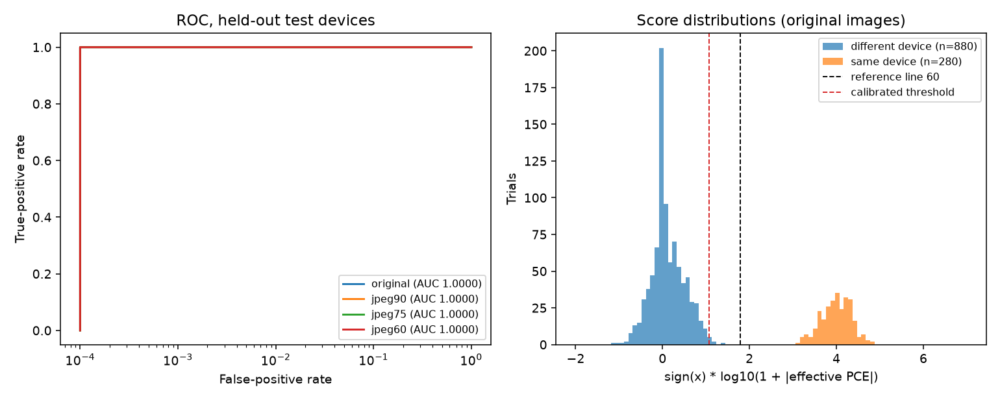

# Validation

What has been measured, on what data, and what has not. Method description:
[SCIENTIFIC_METHODOLOGY.md](SCIENTIFIC_METHODOLOGY.md).

**Summary.** The engine was evaluated on real photographs from 13 smartphones released between 2011 and
2016. Within that scope, on camera-original JPEGs at native resolution, it separated same-device from
different-device comparisons with no false match at the reference threshold and misses confined to one
device. **Nothing has been validated for smartphones released since about 2018, for dedicated cameras,
for cropped or resized images, or for images that passed through messaging or social platforms.** Those
capabilities are labelled experimental or unsupported in the product.

## 1. Evaluation `vision-subset-v1`

Run on 2026-11-12 with algorithm `prnu-wavelet-mle-1.0` (Python 3.12.16, NumPy 2.5.4, SciPy 1.18.1,
PyWavelets 1.10.0, Pillow 13.0.0). Full machine output: `docs/validation/vision_subset_v1_report.md`,
`docs/validation/vision_subset_v1_results.json`. Per-trial scores (`scores.csv`) are produced by the run
and not committed.



### Data

VISION dataset (Shullani et al., EURASIP Journal on Information Security, 2017), © CSP Lab, University of
Florence, CC BY-SA 4.0. Images are downloaded by `scripts/download_vision_subset.sh` and never
redistributed.

| Device | Model | Released | Resolution | Role |
|---|---|---|---|---|
| D02, D10 | Apple iPhone 4s | 2011 | 3264×2448 | calibration |
| D05, D14, D18 | Apple iPhone 5c | 2013 | 3264×2448 | calibration |
| D03 | Huawei P9 | 2016 | 3968×2976 | calibration |
| D06, D15 | Apple iPhone 6 | 2014 | 3264×2448 | test |
| D29, D34 | Apple iPhone 5 | 2012 | 3264×2448 | test |
| D01, D26 | Samsung Galaxy S3 Mini (GT-I8190N / GT-I8190 variants) | 2012 | 2560×1920 | test |
| D11 | Samsung Galaxy S3 | 2012 | 3264×2448 | test |

- **Reference (enrolment) images:** the first 40 flat-field images of each device (`flat`).
- **Test images:** the first 40 natural images of each device (`nat`), camera originals. 520 in total.
- Five model groups contain two or three physical devices, giving same-model different-device trials.

### Protocol

- **Separation of enrolment and test.** Reference and test images come from different capture
  categories. Exact duplicates between the two sets: 0. Near-duplicate test pairs within a device
  (perceptual hash distance ≤ 2): 1, counted and kept.
- **Device-level split.** Six devices are calibration devices and seven are test devices; no device is
  in both. Thresholds derived from data use calibration devices only.
- **Trials.** Every test image is compared with every fingerprint of the same pixel dimensions
  (zero shift, 0° and 180°). Cross-resolution pairs go to the crop-search stratum.
- **Strata.** Same device; same model, different device; different model.
- **Conditions.** Original files, and the test devices' images recompressed in memory at JPEG quality
  90, 75 and 60 (Pillow, default chroma subsampling), compared with fingerprints from original
  reference images.
- **Statistic.** Adjusted signed PCE (section 3.6 of the methodology).
- **Uncertainty.** Exact binomial (Clopper–Pearson) 95% intervals. Trials sharing a device, a
  fingerprint or an image are not independent, so the intervals are narrower than the truth. There are
  13 devices; that, not the trial count, limits what can be generalised.

### Enrolment

All 40 reference images were accepted for every device. Split-half PCE of the fingerprints ranged from
77,000 to 753,000.

### Results: original images, native resolution

All 13 devices, every same-size pair:

| Stratum | Trials | Minimum | Median | 99th percentile | Maximum |
|---|---|---|---|---|---|
| Same device | 520 | −0.9 | 9,667 | 51,438 | 70,757 |
| Same model, different device | 560 | −5.3 | 0.3 | 12.2 | 21.4 |
| Different model | 3,120 | −17.4 | 0.0 | 7.5 | 15.9 |

At the reference line PCE = 60, which was fixed in advance and not tuned on this data:

| | Count | Rate | 95% interval |
|---|---|---|---|
| False matches, all different-device trials | 0 / 3,680 | 0% | 0 – 0.10% |
| False matches, same-model trials only | 0 / 560 | 0% | 0 – 0.66% |
| Misses, same-device trials | 7 / 520 | 1.3% | 0.5 – 2.8% |

Held-out test devices only (280 same-device, 880 different-device trials): 0 false matches
(0 – 0.42%), 0 misses (0 – 1.3%); lowest same-device statistic 1,149; highest different-device 21.4;
AUC 1.0 (the two distributions do not overlap).

Same-model different-device trials score slightly higher than different-model trials (maximum 21.4
against 15.9), consistent with weak residual model-level artefacts, but remain far below the threshold
for these 2011–2016 devices.

### Known failure case found

**All seven misses are from one device, the Huawei P9 (D03): 7 of its 40 natural images (17.5%) score
below 3 against their own fingerprint**, while the other 33 score in the thousands. The seven images
have the same dimensions, orientation, software version, zoom ratio and rendering tag as the others, so
they cannot be recognised from metadata. The cause has not been established. The P9 is a dual-camera
phone that fuses a colour and a monochrome sensor, which is a plausible explanation but is not verified.

Consequences in the product: all P9 images carry `CustomRendered = 1`, which SensorTrace flags and which
blocks a non-match conclusion, so these seven would be reported as *inconclusive*, not as a non-match.
More generally this is direct evidence that a low statistic does not exclude a device.

### Results: recompressed images (test devices)

| Condition | Lowest same-device statistic | Median same-device | False matches at 60 | Misses at 60 |
|---|---|---|---|---|
| Original | 1,149 | 9,997 | 0 / 880 | 0 / 280 |
| JPEG quality 90 | 682 | 7,394 | 0 / 880 | 0 / 280 |
| JPEG quality 75 | 238 | 3,648 | 0 / 880 | 0 / 280 |
| JPEG quality 60 | 131 | 2,080 | 0 / 880 | 0 / 280 |

Recompression lowers the statistic steadily (median falls by about a factor of five at quality 60) but
did not cause a miss at full resolution on these devices. This covers recompression only: real platforms
also resize, which this version does not handle.

### Results: image quality

Thirteen same-device test images had a mean intensity below 60 (dark scenes); the lowest statistic among
them was 101. Too few to state a rate; consistent with the expectation that dark images score lower.
No analysis by texture or saturation level was made.

### Threshold selection from data

For comparison, thresholds were also derived from the calibration devices at a 1% target:
a match threshold of 10.9 and a non-match threshold of 0.14. On the test devices that threshold produced
6 false matches in 880 (0.7%, interval 0.25 – 1.5%), five of them same-model (2.1% of 240). **This
data-derived threshold is not offered in the product.** A 1% target is far too loose for this purpose,
and the calibration set (800 different-device trials) cannot resolve targets much below 1/800. Because
the two score distributions are separated by two orders of magnitude, the data cannot say where between
about 22 and 1,100 a threshold should sit; the literature value of 60 lies in that gap and is retained.

### Crop search (experimental)

1,280 cross-resolution trials (a smaller image searched over every placement inside a larger
fingerprint), all true negatives. Raw PCE reached 37.3; after adjustment for the number of placements
the maximum was 10.7 and none reached 60 (0 – 0.29%). **No true-positive cropped trial exists in this
evaluation, so detection of genuine crops on real images is not validated.** It is verified on synthetic
data only.

## 2. Decision policies shipped

| Policy | Thresholds | Status |
|---|---|---|
| `literature-reference-uncalibrated` (default) | match 60, non-match 10 | Reference lines; no error rate claimed |
| `vision-2017-validated` | match 60, non-match 10 | The same lines with the measurements above attached. For the five models with same-model data (iPhone 4s, 5, 5c, 6; Galaxy S3 Mini) the same-model alternative is treated as addressed |

The non-match line of 10 is an engineering choice: 99.4% of different-device trials and 1.3% of
same-device trials (the P9 images) fell at or below it. A non-match conclusion additionally requires the
quality and fingerprint conditions in the methodology.

## 3. Verification that is not empirical validation

| Check | Result |
|---|---|
| Engine unit, property and regression tests on synthetic sensors | Pass (`make test-engine`) |
| Cross-check against an independent implementation (polimi-ispl/prnu-python) | Shrinkage rule reproduces the reference to correlation > 0.99999; statistics agree within 15% under one definition |
| Multiple-testing adjustment against the worked example in Goljan and Fridrich (2008) | Reproduces PCE 53.77 for α = 10⁻⁵, k = 88,836,025 |

These show the implementation does what the methodology says. They say nothing about accuracy on real
cameras.

## 4. Validation status of each capability

| Capability | Status | Basis |
|---|---|---|
| Fingerprint from flat-field reference images | Validated within scope | 13 devices |
| Fingerprint from natural (non-flat) reference images | **Not validated** | Not tested |
| Fingerprint from fewer than 40 reference images | **Not validated** | Not tested; the literature shows thresholds and power depend on the count |
| Same-size image, older smartphones (2011–2016), camera-original JPEG | Validated within scope | Section 1 |
| JPEG recompression to quality 60 at full resolution | Validated within scope | Section 1 |
| Distinguishing devices of the same model, older smartphones | Validated within scope | 560 trials, 5 model groups |
| Smartphones released since about 2018 | **Not validated.** Published studies report frequent false matches between same-model devices | Product requires controls or calibration and otherwise answers inconclusive |
| Same-model control rule | **Experimental** | Logic tested; no real-data validation on affected devices |
| Dedicated cameras (DSLR, mirrorless, compact) | **Not validated** | No data evaluated |
| 180° and 90° rotated images | Partly validated | 22 of 520 same-device images matched at 180° on real data; 90° on synthetic only |
| Cropped images | **Experimental** | False-match behaviour measured; detection on real crops not measured |
| Resized, zoomed, stabilised or platform-processed images | **Unsupported** | Not tested (VISION contains WhatsApp and Facebook versions; not used) |
| HDR, portrait, night and other multi-frame modes | **Not validated** | One unexplained failure pattern observed (P9) |
| Non-match conclusions | **Experimental** | Threshold is an engineering choice; gating rules not empirically validated |
| Delta-sPCE | **Experimental, information only** | Not validated by its authors or here |
| PNG and 16-bit input | Verified on synthetic data only | |
| Quality flags | Heuristics, **not validated** as predictors | |

## 5. Limits of this evaluation

- Thirteen devices, seven models, three brands, all smartphones from 2011–2016. It represents neither
  current phones nor dedicated cameras.
- Flat-field references and 40 of them per device: a favourable enrolment condition.
- 40 test images per device, taken in sequence from the dataset rather than sampled.
- Negatives share fingerprints and images; intervals assume independence and are optimistic.
- One run, one decoder version. No cross-platform reproducibility run was made.
- No independent replication.

## 6. Reproducing

```bash
make reference-oracle
```

```bash
make eval-data
```

```bash
make evaluate
```

The download is about 2.8 GB. The evaluation takes roughly one to three hours on an 8–10 core machine
and is resumable: finished images are recorded in `scores.partial.jsonl` and fingerprints are cached, so
re-running the command continues where it stopped. Output goes to `data/eval/vision_subset_v1/`. To
evaluate other data, write a manifest like `engine/evaluation/vision_subset_v1.json` and pass it to
`sensortrace evaluate`.

## 7. What would most improve confidence

1. A set of recent smartphones with several units per model and firmware version.
2. Dedicated cameras with several bodies per model.
3. Natural-image reference sets and smaller reference counts.
4. Real cropped, resized and platform-processed images with known source.
5. Investigation of the Huawei P9 failure pattern.
6. Independent replication on other hardware and library versions.
